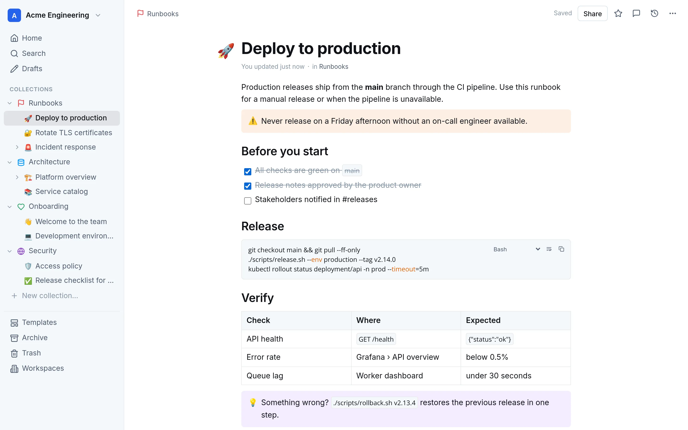

# GetPaper

**The open-source wiki for your team, on your infrastructure.**

[](LICENSE)
[](https://github.com/teopost/getpaper/pkgs/container/getpaper)
[](https://github.com/teopost/getpaper/releases)

**English** · [Italiano](README_ITA.md) · [Website](https://getpaper.it) · [Changelog](CHANGELOG.md)

GetPaper is a self-hosted wiki and knowledge base for teams, inspired by [Outline](https://github.com/outline/outline),
with a **Rust** backend and **multiple workspaces** included. You run it wherever you choose (your own server, a private
cloud or a cloud account you manage), so the documentation stays in your own PostgreSQL database and storage volume.



- **Open source**: MIT license, no account, licence key or telemetry. The server only connects to the services you
  configure (Microsoft Entra ID for sign-in, your SMTP server for emails).
- **Self-hosted**: one Docker Compose file with PostgreSQL, images for amd64 and arm64.
- **Built for teams**: multiple isolated workspaces, groups and roles, Microsoft Entra ID single sign-on.
- **Migration**: imports Confluence space exports (XML or HTML), Wiki.js 2 exports and Markdown exports from Outline,
  Notion, Obsidian, GitBook and BookStack.
- **AI ready**: a built-in [MCP](https://modelcontextprotocol.io) server with scoped, expiring API keys.

**Contents:** [Quick start](#quick-start-docker-image) · [Updating](#updating) ·
[Backup and restore](#backup-and-restore) · [Running from source](#running-from-source) · [Features](#features) ·
[Microsoft sign-in](#microsoft-sign-in-sso) · [Import](#import) · [Export](#export) ·
[MCP server](#mcp-server-for-llms) · [API](#api) · [Differences from Outline](#differences-from-outline) ·
[Contributing](#contributing)

## Quick start (Docker image)

The image published on GitHub Container Registry (`ghcr.io/teopost/getpaper`, for amd64 and arm64) runs without
downloading the sources:

```bash
mkdir getpaper && cd getpaper
curl -fsSLO https://raw.githubusercontent.com/teopost/getpaper/main/deploy/docker-compose.yml
curl -fsSL https://raw.githubusercontent.com/teopost/getpaper/main/.env.example -o .env
# set at least URL and POSTGRES_PASSWORD in .env
docker compose up -d
```

Open the URL and create the first account: it becomes the superadmin.

**Requirements:** a host with Docker and Docker Compose (Linux amd64 or arm64). The Compose file also starts
PostgreSQL 16. Put a reverse proxy with HTTPS (for example Caddy, nginx or Traefik) in front of port 3000 for
production use, and set `URL` to the public HTTPS address.

### Updating

```bash
docker compose pull && docker compose up -d
```

Database migrations run automatically when the application starts. For controlled updates, pin a release in `.env`
instead of `latest`, for example `GETPAPER_IMAGE=ghcr.io/teopost/getpaper:0.2.0`, and read the
[changelog](CHANGELOG.md) before moving to a newer one. Take a backup first.

Image tags: `latest` (every change on `main`), `X.Y.Z` and `X.Y` (releases), `sha-<commit>` (every build).

### Backup and restore

All data lives in two Docker volumes: `getpaper_pgdata` (PostgreSQL) and `getpaper_uploads` (attachments). Back up
both, from the directory that contains `docker-compose.yml`:

```bash
# database (custom format) and attachments
docker compose exec -T postgres pg_dump -U getpaper -Fc getpaper > getpaper-$(date +%F).dump
docker run --rm -v getpaper_uploads:/data:ro -v "$PWD":/backup alpine \
  tar czf /backup/uploads-$(date +%F).tar.gz -C /data .
```

Restore (this replaces the current data):

```bash
docker compose stop app
docker compose exec -T postgres pg_restore -U getpaper -d getpaper --clean --if-exists < getpaper-2026-10-17.dump
docker run --rm -v getpaper_uploads:/data -v "$PWD":/backup alpine \
  tar xzf /backup/uploads-2026-10-17.tar.gz -C /data
docker compose start app
```

Workspace admins can also download a **GetPaper backup** of a single workspace from **Settings → Export** and restore
it on another installation (see [Export](#export)).

## Running from source

```bash
docker compose up -d --build
```

Open http://localhost:3000. The first visit asks you to create the first account and the first workspace.

Useful variables (in a `.env` file next to `docker-compose.yml`, or in the environment):

| Variable | Default | Description |
| --- | --- | --- |
| `URL` | `http://localhost:3000` | Public URL, used in invite and share links |
| `PORT` | `3000` | Port published on the host |
| `ALLOW_SIGNUP` | `true` | With `false`, people can only sign up with an invite (the first user can always sign up) |
| `IMPORT_MAX_MB` | `500` | Maximum size of a ZIP archive to import |
| `SUPERADMIN_EMAILS` | | Accounts that are always superadmins, comma separated (see below) |
| `DEFAULT_LANGUAGE` | `en` | Interface language for users who haven't chosen one: `en`, `it` |
| `DEFAULT_THEME` | `system` | Appearance for users who haven't chosen one: `system`, `light`, `dark` |
| `DEFAULT_CONTENT_WIDTH` | `normal` | Text width in documents: `normal`, `wide`, `full` |

Each user can override language, appearance and text width in **Settings → Profile → Preferences**.
The `DEFAULT_*` values also apply to the sign-in pages and public links.

Data is stored in the Docker volumes `pgdata` (PostgreSQL) and `uploads` (attachments).

Most common commands (`make` with no arguments shows the list):

| Command | What it does |
| --- | --- |
| `make start` / `make stop` | Start / stop the containers (data is kept) |
| `make rebuild` | Rebuild the image from the sources and restart |
| `make restart` | Restart the application only |
| `make logs` | Follow the application log |
| `make status` | Container status and health |
| `make backup` | Dump the database to `/opt/getpaper-backups` (`make backup-clean` deletes old dumps) |
| `make restore FILE=…` | Restore a database dump (asks for confirmation) |
| `make psql` / `make shell` | Database console / shell in the container |
| `make update` | `git pull` and rebuild |

## Features

- **Multiple workspaces**: each user can create and belong to several fully isolated workspaces
  (members, roles, collections, documents, shares, API keys). Switcher at the top left of the sidebar.
- **Collections** with icon and colour, "edit", "read only" or "private" permissions with explicit members,
  drag & drop reordering.
- **Nested documents** with a tree in the sidebar, drag & drop to move and reorder, breadcrumbs.
- **Moving between workspaces**: *Move* also lets you choose the destination workspace (among those you can write
  to). The document moves with its subpages, history, comments and attachments; its public links are revoked.
- **WYSIWYG editor** saved as Markdown: `/` menu, formatting toolbar, Markdown shortcuts, tables, checklists,
  code blocks with highlighting, language picker, copy and wrap, notices (`:::info`, `:::warning`, `:::tip`,
  `:::success`), images and attachments by paste or drag.
- **Mentions** with `@`, as in Outline: people, groups, documents and collections (saved as
  `@[Name](mention://<id>/<user|document|collection>/<id>)`); documents and collections are chips that open with a
  click, also while editing. Whoever is mentioned in a published document gets a notification in the sidebar and an email
  (can be turned off in the profile preferences), if they can read the document.
- Autosave, drafts, publishing, revision history with restore, stars on documents and collections (in the order
  you choose), archive, trash kept for 30 days, templates, comments with replies and resolution.
- **Templates** with variables and placeholders, as in Outline: `{date}`, `{time}`, `{datetime}` and `{author}` are
  replaced when a document is created from the template; placeholders (`!!text!!`, or the placeholder button in the
  formatting menu of a template) are highlighted in the new document and replaced by clicking and typing.
- **Full-text search** in PostgreSQL with highlighted results, a collection filter and search across all your
  workspaces.
- **Public sharing** of documents by link (`/s/...`).
- **Members and roles** (admin, editor, viewer), invites by link or email, personal API keys. Workspace admins can
  **suspend** a member (they can't open the workspace until reactivated; role, groups and permissions are kept);
  superadmins can suspend an account everywhere (no sign-in, sessions closed, API keys stop working).
- **Sharing a document** with people or groups beyond its collection (*Share → People with access*, "can edit" or
  "view only"), also for its nested documents, as in Outline; shared documents appear in **Shared with me**.
- **Following** documents and collections (*Follow* in their menu): a notification, and an email if wanted, when a
  followed document gets a new editing session, a document is published in a followed collection or a document is
  shared with you. People who publish or edit a document follow it automatically.
- **Comments on a passage**: select text and choose *Comment*, also with read-only access; the passage is
  highlighted and the thread shows the quote. The document's Markdown is not changed: when the passage is deleted
  the comment stays, with the quote crossed out.
- **Embeds**: a link to YouTube, Vimeo, Loom, Figma, Google Docs/Sheets/Slides/Forms/Drive, Miro, Spotify or
  CodePen pasted on an empty line is shown in the document; in the `/` menu each service (*YouTube*, *Figma*,
  *Google Sheets*…) or *Embed* asks for the link right in the menu, as in Outline; in Markdown it stays a link
  (`[url](url)` on its own line). **Link previews**: resting the pointer on a link to a document shows its title and
  first lines; previews of external sites are off by default (*General settings → Data protection*), because the
  server then fetches the linked page (public addresses only, 5 seconds, 512 KB).
- **Activity and audit log**: workspace admins see who is active, who changed which document, sign-ins and the
  changes to members, access and settings; superadmins see the sign-ins and settings of the installation
  ([details](#activity-and-audit-log)).
- **Groups**, as in Outline: workspace admins create them, workspace and group admins manage their members; a
  group can be given read or edit access to a collection, and mentioning it with `@group` notifies all of its
  members (mentions can be turned off per group).
- Markdown import and export; single documents can be downloaded as Markdown, HTML (standalone, images
  embedded), PDF (through the browser's print dialog) or Word (.docx).
- **Presentation mode**, as in Outline: a document becomes full screen slides, split at big and medium headings
  and at dividers (arrows, space, F for full screen, Esc to leave).
- Interface in English and Italian, light, dark or automatic theme.

## Microsoft sign-in (SSO)

Sign-in uses Microsoft Entra ID (Azure AD) through OpenID Connect, with the authorization code flow and PKCE.

1. In Entra ID, create a **Web** *App registration* with redirect URI `<URL>/auth/microsoft/callback`,
   for example `https://wiki.example.com/auth/microsoft/callback`.
2. Create a *client secret* and set the variables in `.env`:

| Variable | Description |
| --- | --- |
| `MICROSOFT_CLIENT_ID` | Application (client) ID |
| `MICROSOFT_CLIENT_SECRET` | Client secret |
| `MICROSOFT_TENANT_ID` | Directory (tenant) ID. With `organizations`, accounts from any organization are accepted |
| `MICROSOFT_ALLOWED_DOMAINS` | Optional: only these email domains can sign in (e.g. `example.com,example.org`) |
| `MICROSOFT_AUTO_PROVISION` | `true` (default): the account is created at the first sign-in. With `false`, only invited people get in |
| `PASSWORD_LOGIN` | `false` to allow Microsoft sign-in only |
| `MICROSOFT_CALLBACK_PATH` | Path of the redirect URI: `/auth/microsoft/callback` (default) or `/auth/azure.callback`, the same as Outline, to reuse unchanged the app registration of an Outline instance on the same domain |

Behaviour:

- Accounts are bound to the Microsoft identity (tenant and object id). An existing account with the same email is
  linked only if the tenant is specific or the domains are restricted.
- At the first sign-in the user automatically accepts the pending invites for their email. They also join the
  workspaces that list their domain in **Settings → Details → Allowed domains**, with the default role.
- It also works from the invite page ("Join with Microsoft") and takes the user back to the page they asked for
  before signing in.

## Public links

A published document can be made visible without authentication from **Share → Publish to internet**. The link
looks like `<URL>/s/<token>`, with a random 24-character token (about 143 bits), so it cannot be guessed.

- The page is read only, needs no sign-in and also works with `PASSWORD_LOGIN=false`.
- The page is marked `noindex` and `no-referrer`, so it doesn't end up in search engines or leak through outgoing links.
- The link is revoked from the same panel or from **Settings → Shared Links**.
- Sharing can be disabled for the whole workspace or for a single collection.

## Import

From **Settings → Import** (or from a collection's `…` menu → *Import…*) you upload a `.md`, `.txt` or `.html`
file, or a `.zip` (or `.tar.gz`) archive containing them. Markdown exports from Outline, Notion, Obsidian, GitBook
and BookStack all work; Confluence and Wiki.js have their own importers (below).

- Top-level folders become collections. If you choose a destination collection, they become documents inside it.
- Subfolders become nested documents. `Page.md` and the folder `Page/` are merged.
  `index.md` or `README.md` inside a folder becomes the content of the folder itself.
- The title is taken from the `title:` front matter, the first `# Title` or the file name. Notion's hexadecimal
  suffixes are removed.
- Images and other files become attachments. Relative links between documents, links to attachments and
  Obsidian `[[wiki links]]` are rewritten.
- A single wrapper folder (e.g. `export/…`) is ignored automatically.
- HTML files are converted to Markdown.

### Confluence

You import the **XML** or **HTML** export of a space (Cloud: *Space settings → Export space*;
Server/Data Center: *Space tools → Content Tools → Export*). Upload the ZIP as it is; the importer recognizes the
format automatically.

- **XML** (recommended, contains `entities.xml`): only current pages are imported (not drafts, trash or old
  versions), with the original hierarchy, order and **creation and modification dates**. Mentions become `@name`
  (from the Confluence account). `entities.xml` is not subject to the per-file `MAX_UPLOAD_MB` limit.
- **HTML**: several spaces can be imported together by putting their folders in the same ZIP.

- Each space becomes a collection (with a destination collection, the pages go inside it).
- The hierarchy is rebuilt from each page's breadcrumbs, the order from the page tree in `index.html`.
- Links between pages, images and attachments are rewritten. Attachments listed in the *Attachments* section but
  not shown in the text are added at the end of the page. Export icons and stylesheets are discarded.
- Converted macros: info/note/warning/tip panels → notices, code blocks (with language), expand, task lists,
  tables, statuses, emoticons, mentions (as text). Table of contents and dynamic macros are left out.
- Links to pages of other spaces (not in the export) stay as text.
- Not imported: authors (pages appear as created by the person importing), comments, version history, labels and
  permissions. The PDF export is not supported.

### Wiki.js

Wiki.js 2 content is recognized in two forms, as a ZIP or tar.gz:

- the **export** from *Administration → Utilities → Export* (choose at least *Pages* and *Assets*; Wiki.js writes
  `pages.json.gz` and an `assets/` folder to a folder on its server). `pages.json.gz` is not subject to the per-file
  `MAX_UPLOAD_MB` limit;
- the files of the **Local File System** or **Git** storage (`.md` and `.html` pages with their front matter), also
  the disk backups `wiki-*.tar.gz` as they are.

- Top-level folders become collections and nested paths nested documents. A top-level page with the same path as
  a folder (`guide` and `guide/…`) gives its title to the collection and becomes its first document.
- Creation and modification dates are kept; unpublished pages become drafts of the person importing.
- Pages in a language other than the main one go into a folder named after the language (`fr/…`), as in the
  Wiki.js storage.
- Links between pages (also with the language, `/en/…`, and anchors) and to assets are rewritten; images and other
  assets become attachments.
- Blockquotes marked `{.is-info}`, `{.is-success}`, `{.is-warning}` or `{.is-danger}` (also from the visual editor)
  become notices; image sizes (`=300x`) and `{.class}` attributes are removed. HTML pages are converted to
  Markdown; AsciiDoc pages are imported from the export as the HTML Wiki.js rendered (from the storage files they
  are skipped).
- Not imported: users and authors, comments, page history, tags, navigation and descriptions.

In the **Source** field you choose the tool you are coming from (Confluence, Wiki.js, Outline, Notion, Obsidian, Markdown)
to see its export instructions; with *Automatic detection* (default) the format is recognized from the content of
the ZIP. If the chosen source doesn't match the archive, the import is rejected with a clear message. The result
shows the recognized format.

API: `POST /api/collections.import` (multipart: `file`, optional `source` among `auto`, `confluence`, `wikijs`,
`outline`, `notion`, `obsidian`, `markdown`, optional `collectionId`, `publish`). The response contains `format`
(`confluence-xml`, `confluence-html`, `wikijs-export`, `wikijs-storage` or `markdown`).

## Invitation emails

With an SMTP server configured, invites are sent by email: a message in the inviter's language, with workspace,
role and an *Accept invitation* button (with Microsoft sign-in enabled it says to sign in with the work
account). People who already have an account are added to the workspace right away (the invite window says so) and get a
notice whose link opens that workspace.

- In **Settings → Members → Invite people…** the *Send the invitation by email* checkbox (on by default).
- In the pending invites: *Send email* / *Send again*, the date of the last email and *Email all pending invites*.
- In **General settings → Email** (superadmins): *Check connection* and send a test email to yourself.

| Variable | Description |
| --- | --- |
| `SMTP_HOST`, `SMTP_PORT` | Mail server (without `SMTP_HOST` emails are disabled) |
| `SMTP_USERNAME`, `SMTP_PASSWORD` | Credentials (for SendGrid: `apikey` and the API key) |
| `SMTP_FROM_EMAIL`, `SMTP_FROM_NAME` | Sender; without `SMTP_FROM_NAME` the sender name is the product name |
| `SMTP_SECURE` | `ssl` (port 465), `starttls` (587) or `none`; if empty it is inferred from the port |

## Superadmins and general settings

**Superadmins** manage the settings shared by all the workspaces of the installation, in
**Settings → General settings** (the item is shown to superadmins only):

- **Branding**: product name (if empty it stays *GetPaper*; it is shown in the browser tab, on the sign-in page,
  next to the logo, in public links, in emails and in the welcome document of new workspaces; backup files and the
  MCP server keep the technical name GetPaper), header colour (the top bar; the text colour is chosen automatically
  for contrast) and accent colour (buttons, links). They also apply to the sign-in pages and public links.
- **Data protection**: enables or disables workspace backups, Markdown export (Obsidian vault and single document
  downloads) and public links. The block is enforced by the server; when public links are disabled, existing ones
  stop working until they are enabled again.
- **Defaults for users**: language, appearance and document width. They take precedence over the `DEFAULT_*`
  variables, which remain the starting value.
- **Activity and audit log**: how many days the audit log is kept and whether workspace admins see the documents
  viewed per person (see [Activity and audit log](#activity-and-audit-log)).
- **Superadmins**: list, add by email (the account must exist) and remove (at least one always remains).

The first account created is a superadmin. Superadmins have the *Superadmin* badge in the **Members** list and are
listed in **General settings → Superadmins**. With `SUPERADMIN_EMAILS` (comma separated) you can name accounts that
are always superadmins, for example to recover access. Being a superadmin doesn't give access to workspaces you are
not a member of.

## Activity and audit log

Workspace admins find **Settings → Activity**, with three tabs and a period filter:

- **People**: for each member the role, last activity, last sign-in, number of sign-ins, documents published and
  edited in the period. Clicking a person shows their changes. The number of documents each person viewed is shown
  only if a superadmin enables it (*General settings → Documents viewed per person*, off by default).
- **Changes to documents**: who edited which published document and when, from the revision history (saves of the
  same person within 5 minutes count as one change), filtered by person and collection.
- **Audit log**: sign-ins and failed sign-ins of the members, invites, roles, removals, groups, collections and
  their access, documents published, moved, archived, restored or deleted, public links, API keys, imports,
  exports and workspace settings, with IP address, browser and channel (web, API key, MCP). Filters by type,
  person and text, and **CSV export** (up to 20 000 events).

Superadmins find **Settings → Audit log** for the installation: sign-ins and failed sign-ins (also with unknown
email), new accounts, general settings, superadmins, workspaces created and deleted. As everywhere else, superadmins
don't see what happens inside workspaces they are not admins of.

- Drafts are private: they are not recorded until they are published.
- The log is kept for 90 days by default; superadmins change it in *General settings → Activity and audit log*
  (1 to 3650 days; 0 turns the log off and deletes what was recorded). Turning it off is recorded too.
- The address is the last entry of `X-Forwarded-For` (the one added by the reverse proxy), else `X-Real-IP`, else
  the connection address: run GetPaper behind a reverse proxy, otherwise clients can send any `X-Forwarded-For`.
- None of this is available through API keys. Recording the activity of employees can be subject to labour and
  privacy rules (in Italy art. 4 of the Statuto dei Lavoratori and the GDPR): check them before choosing what to
  enable and for how long.

## Export

From **Settings → Export**:

- **GetPaper backup** (admins only): a ZIP with `getpaper-backup.json` and the `attachments/` folder.
  It contains collections (icon, colour, permissions, members of private collections), documents with hierarchy,
  drafts, templates and archived documents, dates, revision history, comments and attachments. It is restored in
  another instance from **Settings → Import** (source *GetPaper backup* or automatic detection) into the current
  workspace:
  - authors are matched by email to the members of the destination workspace; the rest is attributed to the person
    restoring;
  - ids and links stay the same if they are free; if they are already taken (e.g. restoring into the same instance)
    they are regenerated and internal links rewritten;
  - not included: users and roles, workspace settings, public links, stars, API keys.
- **Obsidian vault**: the published documents the user can read, as Markdown files. One folder per collection,
  nested documents as `Page.md` + `Page/`, internal links as `[[wiki links]]`, attachments in `_attachments/`,
  notices as callouts (`> [!info]`), dates and original title in the front matter. When the vault is imported again
  (source *Obsidian*) callouts and titles are converted back.

API: `POST /api/workspace.export` with `{"format": "backup" | "obsidian"}`, responds with the ZIP.

## MCP server (for LLMs)

The backend exposes an [MCP](https://modelcontextprotocol.io) server on `POST /mcp` (Streamable HTTP transport).
Authentication uses a personal API key, created from **Settings → API Keys & MCP**. When creating it you choose:

- **Access**: *read only* (the LLM searches and reads) or *read and write*;
- **Workspaces**: only the current one, some, or all of the user's workspaces (future ones included);
- **Collections**: all or only some (in that case the LLM sees nothing else, not even drafts without a collection,
  and cannot create collections);
- **Expiry**: none, 30, 90, 180 days or 1 year.

The effective permission never exceeds the user's; a key cannot administer workspaces (members, settings), change
the general settings or create other keys. An expired key is rejected.

A key valid in several workspaces needs a single client configuration: the `list_workspaces` tool lists the key's
workspaces, every tool accepts the optional `workspace` parameter (name or id; without it, the key's default
workspace is used) and `search_documents` searches all of them with `all_workspaces: true`. In the REST API the
workspace is chosen with the `X-Workspace: <id>` header.

```bash
claude mcp add --scope user --transport http getpaper http://localhost:3000/mcp \
  --header "Authorization: Bearer ol_api_..."
```

For other clients (Claude Desktop, Cursor, …):

```json
{ "mcpServers": { "getpaper": { "type": "http", "url": "http://localhost:3000/mcp",
  "headers": { "Authorization": "Bearer ol_api_..." } } } }
```

Available tools:

| Area | Tools |
| --- | --- |
| Workspaces | `list_workspaces`, `workspace_info` |
| Collections | `list_collections`, `get_collection_tree`, `create_collection`, `update_collection` |
| Reading | `search_documents`, `list_documents`, `list_drafts`, `list_templates`, `get_document`, `list_revisions` |
| Writing | `create_document`, `update_document` (also `append_text`), `move_document`, `archive_document`, `delete_document`, `restore_document` |
| Collaboration | `list_comments`, `add_comment`, `share_document`, `unshare_document` |

Documents are referenced by id, urlId or full URL. Collections by id, urlId or name.

## API

Outline-style RPC API: `POST /api/<method>` with a JSON body, response `{ "ok": true, "data": ... }`.
Authentication with the session cookie or `Authorization: Bearer <API key>`.

```bash
curl -X POST http://localhost:3000/api/documents.search \
  -H "Authorization: Bearer ol_api_..." -H "Content-Type: application/json" \
  -d '{"query":"onboarding"}'
```

Main methods: `auth.*`, `teams.*` (workspaces), `users.*`, `invites.*`, `collections.*`, `documents.*`,
`revisions.*`, `stars.*`, `shares.*`, `comments.*`, `attachments.create`, `apiKeys.*`.
The full list is in `server/src/api/mod.rs`.

## Structure

```
server/   Rust backend (axum + sqlx + PostgreSQL), migrations in server/migrations
web/      React + TipTap (ProseMirror) frontend, built with Vite and served by the backend
```

Frontend development with hot reload: start the stack, then `cd web && npm install && npm run dev`
(the Vite proxy forwards `/api` and `/files` to `localhost:3000`).

## Differences from Outline

- No real-time collaboration (Y.js). Saving is automatic; if another user changed the document in the meantime,
  a conflict notice appears with a button to reload.
- Sign-in with email and password or Microsoft Entra ID. No other SSO providers (Google, Slack, generic OIDC)
  or integrations.

## Contributing

Bug reports, ideas and pull requests are welcome: see [CONTRIBUTING.md](CONTRIBUTING.md). Please report security
issues privately as described in [SECURITY.md](SECURITY.md). Changes between releases are listed in
[CHANGELOG.md](CHANGELOG.md).

## License

GetPaper is released under the [MIT](LICENSE) license.
